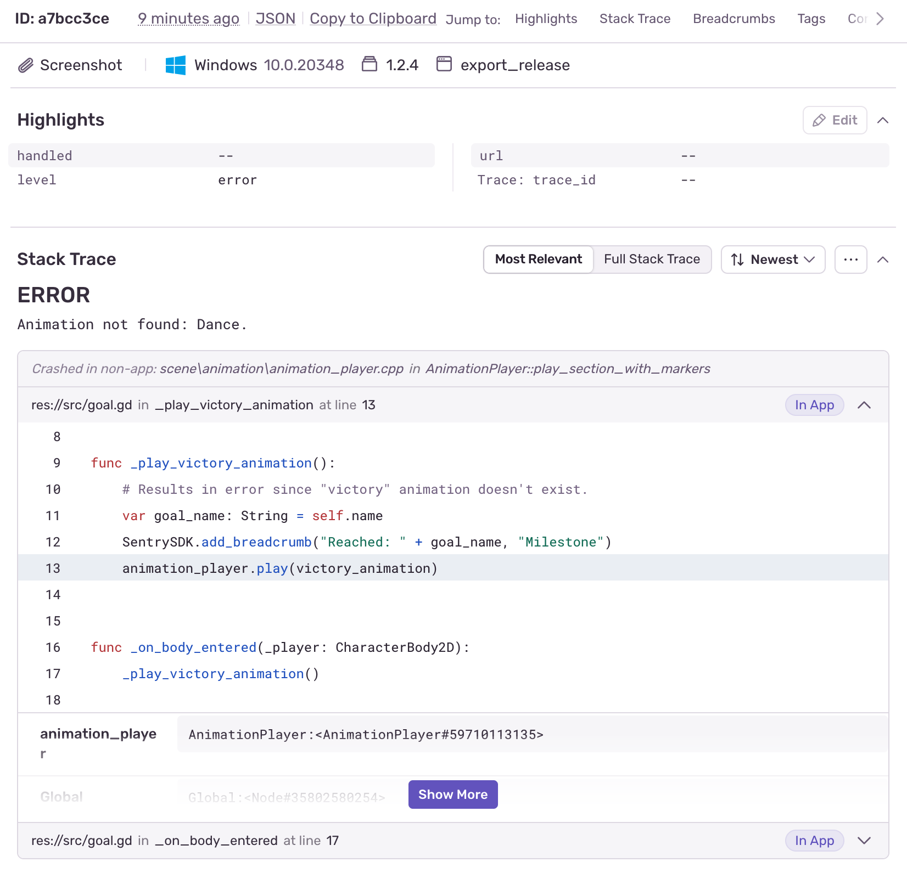

# Sentry for Godot Engine

Sentry for Godot helps you monitor your game's health during QA and after release. It provides insights into crash reports, script errors, hardware information, user feedback, attachments and more through real-time alerting and an intuitive web dashboard. With automatic error reporting, release tracking, and AI-assisted analysis, you can quickly identify, prioritize, and resolve issues for a better player experience.

**Architecture**: Built as a C++ GDExtension on top of mature Sentry SDKs like [sentry-native](https://github.com/getsentry/sentry-native). On Linux and Windows, Crashpad is the default crash backend. To use the native crash backend instead, select it under **Sentry → Crash Backend** in your export preset.

**Feedback Welcome**: We'd love to hear about your experience! Share feedback and ask questions in [Discussions](https://github.com/getsentry/sentry-godot/discussions).

## Minimum supported Godot Engine

| SDK Version              | Required Godot Version |
|--------------------------|------------------------|
| `1.x` and `2.x` releases | Godot 4.5 or later     |
| `0.x` releases           | Godot 4.3 or later     |

For upgrade instructions between major versions, see the [Migration Guide](https://docs.sentry.io/platforms/godot/migration/).

## Supported platforms and architectures

- **Windows**: x86_64, x86_32, arm64
- **Linux**: x86_64, x86_32, arm64
- **macOS**: universal (Intel and Apple Silicon)
- **Android**: arm64, arm32, x86_64, x86_32
- **iOS**: device and simulator
- **Web**: supported in 1.4.0 and later
- **C#/.NET**: supported in 2.0.0 and later
- **W4 console forks**: coming in 2026

Support for additional platforms and architectures may be added in future releases.

## Getting started

Pre-built extension libraries with the demo project are available in [**Releases**](https://github.com/getsentry/sentry-godot/releases).

Check the official [Sentry SDK documentation](https://docs.sentry.io/platforms/godot/) to get started.

In the Godot editor, you can adjust options by going to `Project Settings -> Sentry -> Options`. Feel free to explore the demo `project/` for usage examples.

## Building from source

For build instructions, see our [**Contributing Guide**](https://github.com/getsentry/sentry-godot/blob/master/CONTRIBUTING.md#building-sdk).

Desktop builds default to `sentry_native_shared=yes sentry_native_backend=both`. The editor uses Crashpad. To build a single backend, set `sentry_native_backend=crashpad` or `sentry_native_backend=native`. Static builds remain available with `sentry_native_shared=no` and default to Crashpad.

## Contributing

We appreciate your contributions! Feel free to open issues for feature requests and ask questions in [**Discussions**](https://github.com/getsentry/sentry-godot/discussions). Your feedback is very much welcome!

Check out our [**Contributing Guide**](https://github.com/getsentry/sentry-godot/blob/master/CONTRIBUTING.md).
